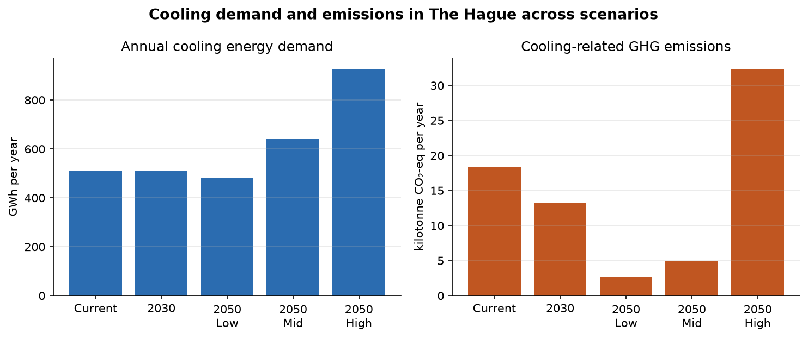
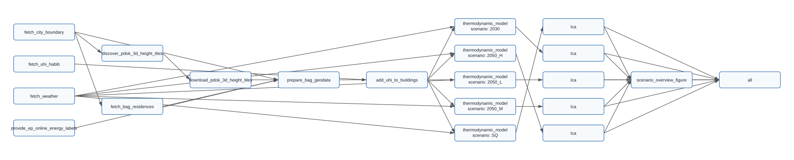

# Cooling for Comfort, Warming the World

**Residential and office cooling and its environmental impacts in The Hague, the Netherlands.**

[](https://github.com/simonvanlierde/msc-thesis-ie/actions/workflows/ci.yml)
[](https://github.com/simonvanlierde/msc-thesis-ie/actions/workflows/dashboard.yml)
[](https://codecov.io/gh/simonvanlierde/msc-thesis-ie)
[](https://simonvanlierde.github.io/msc-thesis-ie/)
[](https://www.python.org/)
[](LICENSE)
[](https://doi.org/10.5281/zenodo.8344580)
[](https://repository.tudelft.nl/record/uuid:32222863-536f-464a-b8c6-6c2283a7249a)

This is the model behind my MSc Industrial Ecology thesis (Leiden University & TU Delft). It
estimates how much cooling the buildings of The Hague need. It also estimates what that cooling
costs in electricity, greenhouse-gas emissions and materials, today and in scenarios for 2030 and
2050.

The model is a tested Python package (`cdm/`). A Snakemake pipeline of 27 rules runs it. The
pipeline fetches the open Dutch data on buildings, building heights and weather, and runs every
scenario. You can also run it in a container. CI checks each pull request with ruff, pytest and a
Snakemake dry run. The input data is archived on Zenodo, and a web dashboard shows the results.

## Interactive dashboard

**[Open the live dashboard →](https://simonvanlierde.github.io/msc-thesis-ie/)**

[](https://simonvanlierde.github.io/msc-thesis-ie/)

The dashboard has three parts. A map colours each neighbourhood of The Hague by its cooling
demand. Charts show how demand changes over a day and over the year. A breakdown shows the
life-cycle impacts. A short summary in plain language explains the results for readers who are not
experts. All of it uses real output from the model.

```bash
cd dashboard && pnpm install && pnpm dev
```

[`dashboard/README.md`](dashboard/README.md) explains how to rebuild its data, how it handles
accessibility and how it deploys to GitHub Pages.

## Key findings

These are the results of the current model, and the dashboard shows the same ones. The model uses
weather from 2021–2025 with the urban heat island added, and the carbon intensity of the 2025
electricity grid. `scripts/paper_numbers.py` prints these numbers from `results/`. The 2023 thesis
used older weather and grid data, so its numbers differ.



- The Hague needs about **527 GWh** of cooling a year. Offices have only **11%** of the floor
  area, but they use **54%** of that cooling and cause **79%** of the greenhouse-gas emissions
  from cooling.
- An estimated **54%** of the cooling demand is not met today. The gap is worst in the
  lower-income neighbourhoods, where the heat island is strongest.
- By 2050, cooling demand changes by **−7%** in the low scenario and by **+79%** in the high
  one, compared with today (**+24%** in the middle one). Emissions fall in every 2050 scenario
  except the high one, where they rise by **76%**.

The [thesis](https://repository.tudelft.nl/record/uuid:32222863-536f-464a-b8c6-6c2283a7249a)
has the full method and discussion.

## How the model works

1. **Geospatial data.** The model takes building footprints and attributes from the Dutch BAG
   (*Basisregistratie Adressen en Gebouwen*, the national register of addresses and buildings).
   It sorts the buildings into archetypes: groups of similar buildings.
2. **Thermodynamic modelling.** An hourly heat-balance model counts the heat that enters and
   leaves each building: through the building shell, through air leaks and ventilation, from the
   sun, and from people and equipment inside. KNMI weather data drives it. The result is the
   cooling energy and the peak power demand of each building.
3. **Environmental impact assessment.** The model estimates the life-cycle impacts on climate
   change, abiotic resource depletion and crustal scarcity. It counts both the electricity the
   cooling uses and the cooling equipment itself.

## Getting started

The large spatial input datasets are on Zenodo
([10.5281/zenodo.8344580](https://doi.org/10.5281/zenodo.8344580)), not in this repository. The
Snakemake pipeline can also fetch them from the official PDOK APIs (the Dutch government's
geodata service).

I recommend [uv](https://docs.astral.sh/uv/):

```bash
git clone https://github.com/simonvanlierde/msc-thesis-ie.git
cd msc-thesis-ie
uv sync                 # locked environment from uv.lock
uv run jupyter lab      # open main.ipynb and gis.ipynb
```

<details>
<summary>With pip</summary>

```bash
git clone https://github.com/simonvanlierde/msc-thesis-ie.git
cd msc-thesis-ie
python -m venv .venv && source .venv/bin/activate
pip install .
jupyter lab
```

</details>

## Repository structure

| Path | Description |
| --- | --- |
| `cdm/` | The model package (see below). |
| `main.ipynb` | End-to-end notebook: cooling demand, environmental impacts, sensitivity analysis, result figures. |
| `gis.ipynb` | Preparation of the BAG geospatial data and spatial visualisations. |
| `Snakefile`, `config/` | The reproducible pipeline and its city / weather configuration. |
| `data/input/parameters/` | All model input parameters, organised per scenario. |
| `data/output/` | Committed reference results per building type and energy label. |
| `dashboard/` | The interactive web dashboard. |
| `scripts/` | Data acquisition and pipeline entry points. |
| `docs/` | The headline figure and the script that regenerates it. |
| `tests/` | Unit tests for the geometric, thermodynamic and environmental functions. |

Inside `cdm/`:

| Module | Role |
| --- | --- |
| `readers.py` | Reading, joining and preparing the building data. |
| `parameters.py`, `constants.py` | Scenario parameters and physical constants. |
| `geometric.py` | Building geometry: facade orientation, window and wall areas. |
| `thermodynamic.py` | The hourly heat-balance and cooling-demand calculations. |
| `environmental.py` | Life-cycle environmental impacts of cooling. |
| `uhi.py` | Hourly urban heat island per building: scales the Habib et al. UHImax ceiling by the weather. |
| `time_series.py` | KNMI weather retrieval and time-series construction. |
| `aggregation.py` | Aggregation of building-level results. |
| `sensitivity_analysis.py` | Scenario and one-at-a-time sensitivity analysis. |
| `figures.py`, `figures_sensitivity.py` | Plotting helpers for the result figures. |

## Reproducible pipeline

The analysis in the notebooks is also a [Snakemake](https://snakemake.readthedocs.io/) workflow.
The workflow calls the same model code in `cdm/`. It does not reimplement the science.



```bash
uv sync                                                  # once
uv run snakemake --cores 4                               # scenario results + overview figure
uv run snakemake --configfile config/smoke.yaml --cores 4  # fast end-to-end check (minutes), under results/smoke/
```

Or run it in a container, so nothing depends on your own setup:

```bash
docker build -t cooling-demand .
docker run --rm -e EP_ONLINE_API_KEY -v "$PWD:/work" cooling-demand snakemake --cores 4
```

The pipeline writes everything it makes under `results/`. You can change that folder with
`results_dir` in `config/sources.yaml`. The committed reference results in `data/output/` and
`docs/` stay untouched. So you can repeat a run safely, and compare its output with the reference
directly:

```bash
diff results/CDM_results_SQ_full.csv data/output/CDM_results_SQ_full.csv
```

Git ignores `results/` and the fetched inputs in `data/raw/`. Each rule writes a log under
`results/logs/`. The model stages also record their run time under `results/benchmarks/`.

### Opt-in targets

These targets are heavy, so I kept them out of the default `all` target:

```bash
# Journal-paper figures (F1, F2, F5) and the manuscript numbers (results/paper_numbers.json).
uv run snakemake --cores 4 paper

# One-at-a-time sensitivity analysis of the SQ scenario: 21 steps per parameter, single-threaded
# (about 20 hours on the full stock). Set --config sa_steps=N for a coarser sweep.
uv run snakemake --cores 4 sensitivity

# Rebuild the dashboard data in dashboard/public/data from the scenario results.
uv run snakemake --cores 4 dashboard_data

# Cooling-technology-mix sensitivity: 30 ordered technology pairs × a 20-step mix sweep,
# each running the full model over the building stock. Lower --calculation-steps for a
# faster, coarser table.
uv run snakemake --cores 4 cooling_mix

# Clip the RIVM urban-heat-island raster to the city (downloads a ~1.95 GB national ZIP once).
uv run snakemake --cores 4 data/input/geodata/UHI_effect_TheHague.tif

# Execute the analysis notebooks headless, keeping the executed copies as artifacts. gis needs
# the UHI raster above; main needs a sample subset or ample RAM (its figures keep the full hourly
# time series in memory).
uv run snakemake --cores 4 notebooks
```

### Configuring the city and weather window

Both are declared in `config/sources.yaml`:

```yaml
city:
  name: "'s-Gravenhage" # official municipality name (fetched from PDOK)
  weather_station: 330 # nearest KNMI station
weather:
  start_year: 2021
  end_year: 2025
```

The pipeline fetches the municipal boundary and its bounding box from PDOK by name. To switch
cities, change the name and pick the nearest KNMI station. The pipeline clips the buildings to the
boundary, so the results cover exactly that municipality. To override the settings without editing
the file:

```bash
uv run snakemake --config city='{name: Rotterdam, weather_station: 344}' --cores 4
```

### EP-Online energy labels

`provide_ep_online_energy_labels` downloads the full public export of energy labels through the
EP-Online v5 API. Request a key at <https://www.ep-online.nl/PublicData>. Then put it in a `.env`
file at the repo root:

```bash
EP_ONLINE_API_KEY=your-key-here
```

The rule gets the signed download URL, streams the ZIP, and extracts the CSV to
`data/raw/ep_online/current/energy_labels.csv` (~1.5 GB uncompressed). It skips the download when a
valid file is already there. The rule reads the key from the environment or from `.env`, and the
key is never committed.

<details>
<summary>Pipeline stages</summary>

| Rule | Existing analysis step | Main inputs | Main outputs |
| --- | --- | --- | --- |
| `fetch_city_boundary` | Municipal extent by name | PDOK Bestuurlijke gebieden OGC API `gemeentegebied` | city boundary GeoJSON + CRS84 bbox |
| `fetch_bag_residences` | Official BAG residence/use acquisition | PDOK BAG OGC API `verblijfsobject`, city bbox | `data/raw/pdok_bag/verblijfsobject_{city}.gpkg` |
| `discover_pdok_3d_height_tiles` | Height-tile discovery | PDOK 3D Basisvoorziening OGC API `hoogtestatistieken_gebouwen`, city bbox | height-tile manifest |
| `download_pdok_3d_height_tiles` | Official height geodata acquisition | PDOK 3D Basisvoorziening tile download links | local GeoPackage ZIP tiles and manifest |
| `provide_ep_online_energy_labels` | Credentialed energy-label source boundary | EP-Online public export | `data/raw/ep_online/current/energy_labels.csv` |
| `fetch_weather` | KNMI weather-series retrieval | KNMI hourly API (station + year window), committed backup fallback | `results/weather/knmi_{station}_{start}_{end}.csv` |
| `prepare_bag_geodata` | Scripted replacement for the BAG/geodata joins in `gis.ipynb` | PDOK BAG residences, PDOK 3D height tiles, EP-Online labels, city boundary (clip) | `results/geodata/BAG_buildings_with_residence_data_nouhi_full.gpkg` |
| `fetch_uhi_habib` | Fetch + extract the Habib et al. UHImax raster for the city | 4TU national UHImax zip (cached, ~4.5 GB one-time) | `data/input/geodata/UHImax_habib_TheHague_5m.tif` |
| `add_uhi_to_buildings` | Vectorized per-building neighbourhood-mean UHImax join | BAG geodata (no-UHI), Habib UHImax raster | `results/geodata/BAG_buildings_with_residence_data_full.gpkg` |
| `thermodynamic_model` | cooling-demand model from `main.ipynb` | processed BAG geodata, `parameters.toml` (per scenario), weather CSV, load-factor inputs | `results/intermediate/buildings_with_cooling_demand_{scenario}_full.gpkg` |
| `lca` | environmental-impact and aggregation steps from `main.ipynb` | cooling-demand geodata and scenario parameters | `results/CDM_results_{scenario}_full.csv` and CDM geodata |
| `scenario_overview_figure` | README headline figure script | scenario result CSVs | `results/figures/scenario_overview.png` |
| `cooling_mix_sensitivity` (opt-in) | cooling-technology-mix sensitivity cells in `main.ipynb`, extracted to `scripts/run_cooling_mix_sensitivity.py` | processed BAG geodata, SQ parameters, weather CSV | `results/cooling_mix_elasticities_table.csv` |
| `fetch_uhi_raster` (opt-in) | RIVM urban-heat-island raster, previously a manual download | national UHI ZIP (RIVM), city bbox | `data/input/geodata/UHI_effect_TheHague.tif` (clipped) |
| `run_main_notebook` / `run_gis_notebook` (opt-in) | execute the analysis notebooks headless; keep the executed copy | pipeline outputs the notebook reads, `cdm/`, the notebook | `results/notebooks/{main,gis}.executed.ipynb` |

PDOK data is licensed under Public Domain Mark 1.0 (BAG, boundaries) and CC BY 4.0 (3D
Basisvoorziening). I checked the column names of the PDOK 3D height data against a 2025
`hoogtestatistieken_gebouwen` tile (`identificatie`, `status`, `oorspronkelijkbouwjaar`,
`rf_h_ground`, `rf_h_roof_70p`). If a later release changes these columns,
`scripts/gis/prepare_pdok_model_geodata.py` stops with an error that lists the columns it found. It
does not guess.

</details>

## Development

The project uses the Python tools from [Astral](https://astral.sh/):

```bash
uv run ruff check .            # lint
uv run ruff format .           # format
uv run ty check                # type check (informational)
uv run pytest                  # tests
```

CI runs the same checks on every pull request ([workflow](.github/workflows/ci.yml)). They also run
locally once you install the git hooks:

```bash
uv run pre-commit install
```

On commit, the hooks run ruff (lint and format), the dashboard formatter and `ty`. On push, they
run the test suite and the dashboard checks. `ty` reports its findings without blocking, as in CI.

To regenerate the committed figure and the pipeline graph (DAG):

```bash
uv run python docs/make_overview_figure.py

# Reproduces the committed SVG (no Graphviz binary required)
uv run snakemake --dag | uv run python scripts/dot_to_simple_svg.py > docs/pipeline_dag.svg
```

## Citation

If you use this work, please cite the thesis and the dataset (see [`CITATION.cff`](CITATION.cff)):

> van Lierde, S. (2024). *Cooling for Comfort, Warming the World: Residential and Office Cooling and
> its Environmental Implications in The Hague.* MSc thesis, Industrial Ecology, Leiden University &
> TU Delft.

## Acknowledgements

Supervised by Prof. ir. Peter Luscuere and Dr. Benjamin Sprecher.

## License

This project is released under the [GNU General Public License v3.0](LICENSE).
