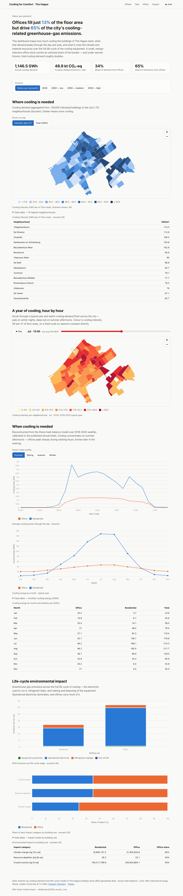

# Cooling for Comfort: dashboard

This dashboard shows the results of my MSc thesis model: how much cooling the buildings of The
Hague need, and the life-cycle climate impact of that cooling. It turns the thesis result files
into three views:

- **Where:** a map that colours the city's 112 neighbourhoods (buurten) by cooling demand.
- **When:** profiles over a summer day and over the months. You can switch them between cooling
  demand and the electricity used to meet it.
- **Impact:** the life-cycle greenhouse-gas emissions, split into their sources, with one stacked
  bar per scenario.

A summary in plain language states the main finding at the top, so nobody has to read a chart to
get it.

**[Open the live dashboard →](https://simonvanlierde.github.io/msc-thesis-ie/)**



## Where the data comes from

Every number comes from the thesis model. Three small build scripts (`scripts/*.py`) convert
the model outputs into JSON and GeoJSON for the web:

| Script | Output | Source | Notes |
| --- | --- | --- | --- |
| `build_scenarios.py` | `public/data/scenarios.json` (~47 kB) | `results/CDM_results_*.csv` (committed) | Per-archetype cooling + LCA totals for all 5 scenarios. A self-check reproduces the README headline (offices: 11% area, 54% demand, 79% GHG) from the built data. |
| `build_choropleth.py` | `public/data/cooling_by_buurt.geojson` (~127 kB) | per-building GPKG + CBS buurten (fetched by the `fetch_cbs_buurten` rule) | 59,381 buildings aggregated to 112 buurten by centroid, geometry simplified and reprojected to WGS84. Buurt sums match the archetype totals to 0.00% for the present-day (SQ) scenario. |
| `build_temporal.py` | `public/data/temporal.json` (~33 kB) | per-building GPKGs + committed weather/parameter CSVs | Re-runs the thesis heat-balance model on a stratified building sample, once per scenario (climate, UHI, comfort threshold and renovation come from the scenario parameters), averages 2021–2025 weather into a typical year and exports the hottest week hour by hour. Calibrated per use to the citywide archetype totals, so the magnitudes include projected building-stock growth. Per-building annual `E_cooling` reproduces the published value to ~0.03% median error (SQ; ~0.8% for 2050 M). |

The spatial and temporal builds need the per-building GeoPackages from the Zenodo dataset
([10.5281/zenodo.8344580](https://doi.org/10.5281/zenodo.8344580)). Git ignores those files. The
buurt boundaries come from CBS (Statistics Netherlands) through the pipeline. The pre-built JSON
in `public/data/` is committed, so the dashboard runs and deploys without any of these inputs.

### Caveats

- The page opens on the **2050 medium** path, so the map first shows that scenario. The
  **present-day (SQ)** scenario is one click away.
- Only in SQ do the per-building geometry and the archetype totals describe the same buildings,
  so only there do they agree exactly. The future scenarios add growth of the building stock to
  the archetype totals, but the per-building geometry does not include that growth. So their map
  sums are ~10–12% below the scenario total. The map still shows them, with a label that says so.
- The temporal profiles use representative building geometry. Only the footprint's minimum
  bounding rectangle (MBR) is rebuilt; the physics is the thesis code, unchanged. Today's
  buildings set the shape of each profile. Its size is calibrated per use to the same citywide
  totals as the impact charts, so all sections agree. To use an exact hourly export from a
  notebook run instead, replace `temporal.json`.

## Run it locally

```bash
cd dashboard
pnpm install
pnpm dev          # http://localhost:5183
```

That's all you need: the committed JSON drives everything.

### Rebuild the data (optional)

You need the repo's Python environment for the model. You also need the Zenodo geodata in
`data/input/geodata/` and `data/output/geodata/`:

```bash
# from the repo root, in the model venv
cd dashboard
pnpm data         # runs the three build_*.py scripts
```

`build_scenarios.py` needs only the Python standard library, so it always works. The other two
skip cleanly when the geodata is missing.

Each script takes the path arguments `--results-dir`, `--geodata-dir`, `--divisions` and `--out`.
They default to the committed reference results in `data/output/`, so the scripts can read from
wherever the model writes. The Snakemake pipeline runs them as a target:

```bash
# regenerate all three datasets from the pipeline's results/ outputs
snakemake dashboard_data
```

## Deploy

The build is a static single-page app in `dist/`.
[`.github/workflows/dashboard.yml`](../.github/workflows/dashboard.yml) publishes it to GitHub
Pages on every push to `main` that changes `dashboard/`. Pull requests run the same quality and
accessibility checks, but do not deploy.

Live at <https://simonvanlierde.github.io/msc-thesis-ie/>.

## Accessibility

Accessibility uses the same setup as `tide` and `credit-heatmap`:

- You can use every control with the keyboard. The controls are radio groups shown as
  segmented buttons, there is a skip link, and focus is always visible. Each control sits next to
  the view it changes, not hidden inside a chart card.
- Every chart and the map have an accessible label. Each view also has a **data table** as a
  fallback, so nothing is only available as a chart or only on hover.
- The colours are safe for colour-blind readers. The map uses shades of one blue. Residential is
  blue and office is orange. Each colour has one job: magenta marks keyboard focus, and no chart
  uses it. Colour never carries meaning on its own. The map legend gives the number ranges, a
  value strip shows where every neighbourhood falls, and every value is in a table.
- The light and dark themes are both designed by hand, not flipped automatically, and both are
  checked for contrast. An inline script sets the theme before the page first draws, so a saved
  theme choice never flashes the other theme on load.
- `@axe-core/playwright` tests the production build in **both themes** (`pnpm test:e2e`). The
  test fails on any serious or critical WCAG 2.2 A/AA violation.

## Stack

The dashboard uses Vite, React and TypeScript, with [nivo](https://nivo.rocks) for the charts
and [MapLibre GL](https://maplibre.org) for the map. [Biome](https://biomejs.dev) lints and
formats. Vitest unit-tests the data transforms, and Playwright with axe tests accessibility.
`pnpm check` also runs pre-commit, through the repo-root [pre-commit](../.pre-commit-config.yaml)
config. Vite is pinned to 7.x, because the rolldown bundler in Vite 8 currently breaks MapLibre's
GeoJSON web worker in production builds.

The fonts are served from this site. [Newsreader](https://fonts.google.com/specimen/Newsreader)
sets the wordmark, the headings and the main headline. [Public Sans](https://public-sans.digital.gov)
sets the body text and every figure, because a serif on a stat value reads as decoration. Both are
variable fonts, cut down to the `latin` subset in `public/fonts/`. There is no font CDN and no
external request.

The map draws over the positron and dark-matter basemaps from [CARTO](https://carto.com), which
add streets and place names and need no API key. If that CDN is unreachable, the map falls back
to a plain background, so the neighbourhood colours still work offline. The CARTO and
OpenStreetMap credits show on the map when the basemap loads.

```bash
pnpm check        # typecheck + lint + coverage + build
pnpm test         # unit tests (data transforms)
pnpm test:e2e     # accessibility, light + dark
pnpm og           # rebuild the social card + favicon (see note below)
```

`scripts/build_og.mjs` generates the social-preview card (`public/og.png`), the favicon
(`public/icon.svg`, the city silhouette) and the apple-touch icon. It draws them from the thesis
output itself: the headline number, the heat band over the year, and the buurt geometry. It
renders with the Playwright Chromium that the accessibility tests already install, so it adds no
dependency. It skips cleanly when its inputs are missing.

The band is a grid of 12 months by 24 hours, rebuilt from `temporal.json`. Each month takes the
daily shape of its season, scaled to that month's total energy. There are only four seasonal
profiles, so months in the same season differ in size but not in shape. At 168 px you can't see
that, and it keeps the card on the same data the dashboard reads.
