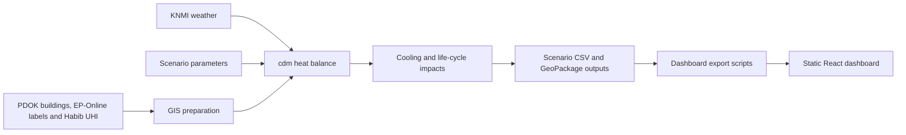

# Architecture

The Python package `cdm` calculates hourly building heat balances and life-cycle impacts.
Snakemake connects acquisition, building-stock preparation, scenario calculations and exports.
The [pipeline guide](pipeline.md) describes its targets, settings and optional inputs.

`config/` selects the city and weather period; `data/input/parameters/` holds scenario assumptions.
The full run writes to `results/`. `data/output/` holds the 2023 thesis results, which are not the current model output.
The dashboard reads JSON and GeoJSON exports from `dashboard/public/data/`; it runs no Python in the browser.
The notebooks provide interactive analysis using the same model package.

Unit tests cover the model and dashboard transformations. The pipeline smoke configuration exercises the stages together.
CodSpeed benchmarks measure the model stages and GIS reads with synthetic inputs.
